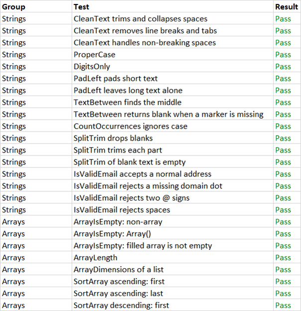

# VBA Utilities Library

The helper functions every VBA project ends up needing (logging, error handling, arrays, files, sheets and text), written once, documented and covered by a built-in test suite.


---

## The Problem

Most VBA projects start by rewriting the same things: find the last row, check whether a file exists, turn off screen updating, show an error message. Each copy is slightly different, none is tested, and when a macro fails halfway the user is left with calculation switched to manual and no idea what went wrong.

## The Solution

Seven small modules you can import into any workbook. Each one is independent (except where noted), so take only what you need.

| Module | What it gives you |
|---|---|
| [`modLogger`](src/modLogger.bas) | `LogInfo`, `LogWarning`, `LogError` to a **Log** sheet and optionally a text file; minimum level filter |
| [`modErrorHandler`](src/modErrorHandler.bas) | `HandleError` (restores Excel, logs, tells the user), `FastMode`, `RaiseAppError`. Needs `modLogger` |
| [`modArrayUtils`](src/modArrayUtils.bas) | `RangeToArray`, `ArrayToRange`, `UniqueValues`, `SortArray`, `FilterRows`, `GetColumn`, `ArrayContains` |
| [`modFileUtils`](src/modFileUtils.bas) | `FileExists`, `FolderExists`, `EnsureFolder`, `ListFiles` (with subfolders), `ReadTextFile`, `WriteTextFile`, `PickFile`, `PickFolder`, path helpers |
| [`modSheetUtils`](src/modSheetUtils.bas) | `SheetExists`, `GetOrCreateSheet`, `LastRow`, `LastColumn`, `HeaderColumn`, `DataRange` |
| [`modStringUtils`](src/modStringUtils.bas) | `CleanText`, `ProperCase`, `DigitsOnly`, `PadLeft`, `TextBetween`, `SplitTrim`, `IsValidEmail` |
| [`modTests`](src/modTests.bas) | `RunAllTests`: 80 checks written to a **Tests** sheet as Pass / Fail |

## Examples

**A macro that cannot leave Excel in a broken state**

```vb
Public Sub ImportSales()
    Const PROC As String = "ImportSales"
    On Error GoTo Fail
    FastMode True                       ' screen updating, events and calculation off
    LogInfo PROC, "Started"

    Dim filePath As String
    filePath = PickFile("Select the sales file")
    If Len(filePath) = 0 Then RaiseAppError "No file was selected."

    ' ... the work ...

    LogInfo PROC, "Finished"
Done:
    FastMode False                      ' everything back exactly as it was
    Exit Sub
Fail:
    HandleError PROC                    ' restores Excel, logs the error, tells the user
    Resume Done
End Sub
```

**Work in memory instead of cell by cell**

```vb
Dim data As Variant, northRows As Variant
data = RangeToArray(DataRange(Worksheets("Sales")))     ' whole sheet in one read
northRows = FilterRows(data, HeaderColumn(Worksheets("Sales"), "Region"), "North")
ArrayToRange northRows, GetOrCreateSheet("North").Range("A1")   ' one write
```

**Columns found by name, so the code survives an inserted column**

```vb
amountColumn = HeaderColumn(ws, "Amount")
If amountColumn = 0 Then RaiseAppError "The Amount column is missing."
```

**Files and folders**

```vb
EnsureFolder "C:\Reports\2026\June"                     ' creates all missing levels
For Each filePath In ListFiles("C:\Inbox", "*.csv", includeSubfolders:=True)
    LogInfo "Import", "Found " & FileNameOf(filePath)
Next filePath
```

## Tested

Click **Run All Tests** on the Start sheet. Every function is exercised, including real files in a temporary folder and a deliberately raised error, and the result is written to the **Tests** sheet:

| Group | Checks |
|---|---|
| Strings | 17 |
| Arrays | 23 |
| Sheets | 12 |
| Files | 18 |
| Logging and errors | 10 |



The tests double as usage examples: to see how a function is meant to be called, find it in [`modTests.bas`](src/modTests.bas).

## How to Use

**Try it:** download `VBAUtilities.xlsm`, open it (click **Enable Content** if prompted) and click **Run All Tests**.

**Use it in your own workbook:**

1. Press `Alt + F11` to open the VBA editor
2. Go to **File → Import File** and choose the `.bas` files you need from `src`
3. Call the functions from your own code

No library references are required; everything is late-bound.

## Project Structure

```
vba-utilities-library/
├── VBAUtilities.xlsm         # all modules, with the test runner
├── src/
│   ├── modLogger.bas
│   ├── modErrorHandler.bas
│   ├── modArrayUtils.bas
│   ├── modFileUtils.bas
│   ├── modSheetUtils.bas
│   ├── modStringUtils.bas
│   └── modTests.bas
├── images/                   # screenshot for this README
├── README.md
└── LICENSE
```

## Roadmap

- [ ] `modDateUtils`: financial year, quarter and working-day helpers
- [ ] `modOutlook`: late-bound email drafts with attachments
- [ ] Progress bar for long-running macros

---

**Author:** [Swaminathan Narayanan](https://www.linkedin.com/in/swaminathan-narayanan-9781a7154/): Data Analytics | Excel & VBA Automation | Python | SQL | Power BI
